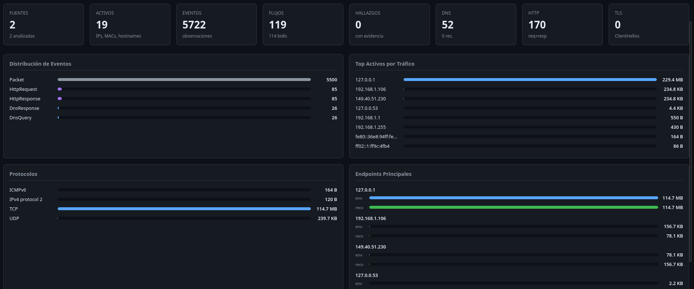
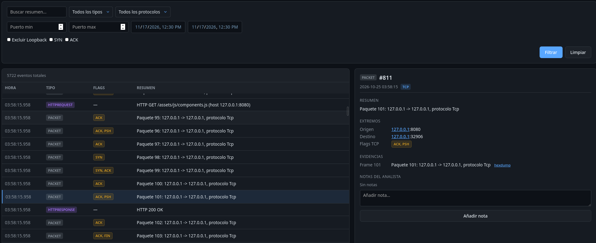
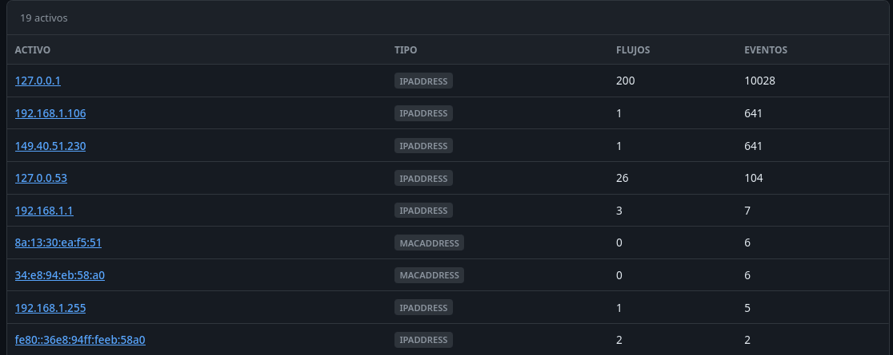
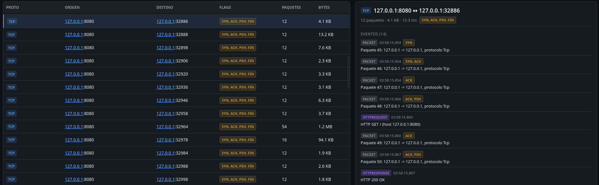
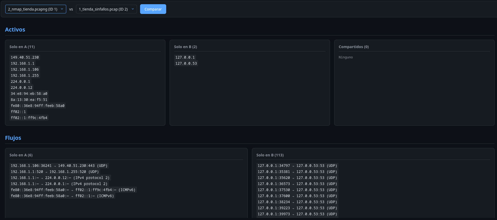
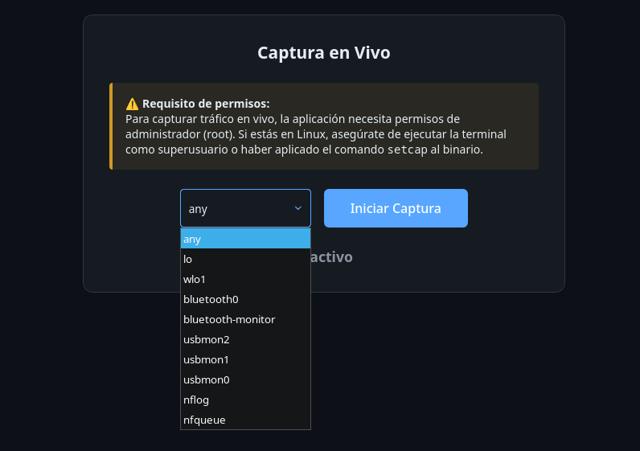

# Watchouttt - Herramienta de Forense de Red y Caza de Amenazas

Watchouttt es una herramienta de alto rendimiento y ligera para Forense de Red y Caza de Amenazas, construida completamente en Rust y Tauri. Sirve como una alternativa moderna y automatizada a los analizadores de paquetes tradicionales como Wireshark, enfocandose en la inspeccion profunda de paquetes, la deteccion automatica de anomalias y la generacion de informes.

Disenada para analistas de ciberseguridad, equipos SOC y administradores de red, Watchouttt procesa archivos .pcap y .pcapng (o trafico en vivo) para extraer inteligencia procesable, identificar patrones maliciosos y correlacionar eventos al instante.

## Capturas de Pantalla

| Vista General | Análisis de Eventos |
| :---: | :---: |
|  |  |

| Activos | Flujos |
| :---: | :---: |
|  |  |

| Comparación (Diff) | Captura en Vivo |
| :---: | :---: |
|  |  |

## Caracteristicas Principales

- Motor en Rust ultra rapido: Maneja archivos PCAP masivos sin consumir toda la memoria RAM. Utiliza un reensamblador TCP personalizado (fuera de orden) y tecnicas de zero-copy.
- Captura de trafico en vivo: Captura trafico directamente desde las interfaces de red de Linux (usando libpcap) y lo inyecta automaticamente en el motor forense.
- Deteccion automatica de amenazas:
  - DNS Tunneling: Detecta intentos de exfiltracion mediante consultas DNS sobredimensionadas.
  - Beaconing: Identifica llamadas de Comando y Control (C2) analizando la periodicidad y el jitter de las conexiones.
  - Port Scanning: Detecta reconocimiento de red y movimiento lateral.
  - Baselines Estadisticos: Usa Z-scores modificados para encontrar valores atipicos en el trafico de activos comparados con su comportamiento historico.
- Correlacion de Eventos: Agrupa eventos aislados que comparten un activo comun en una ventana de tiempo para revelar el panorama completo.
- Soporte profundo de protocolos: Parsea DNS (incluyendo CNAMEs), HTTP/1.1 y TLS (extraccion de SNI) de forma nativa sin dependencias externas pesadas.
- Interfaz Moderna: Una interfaz oscura con acentos neon construida con Tauri, con vista de doble panel para triaje rapido, graficos interactivos y lineas de tiempo.
- Informes Profesionales: Exporta hallazgos a HTML (con graficos SVG), Markdown, CSV o JSON.

## Arquitectura y Tecnologias

- Motor Core: Rust (Crates: pcap, serde, tokio, once_cell).
- Frontend: TypeScript, Vite, CSS/HTML Vanilla.
- Framework de Escritorio: Tauri v2 (WebKitGTK).
- Seguridad: Modelo de permisos estricto, verificacion de integridad de evidencias con SHA-256.

## Empezando (Para Usuarios)

No necesitas compilar el codigo para usar Watchouttt.

1. Ve a la pagina de Releases de este repositorio.
2. Descarga el instalador .rpm (Fedora/RHEL), .deb (Ubuntu/Debian) o .AppImage (Portable).
3. Instala el paquete y abre Watchouttt.

### Requisito para Captura en Vivo en Linux

Para capturar trafico en vivo, libpcap requiere privilegios elevados. Despues de instalar, ejecuta este comando para permitir que Watchouttt analice paquetes sin necesidad de usar sudo:

sudo setcap cap_net_raw,cap_net_admin=eip /usr/bin/watchoutt

## Compilar desde el Codigo Fuente (Para Desarrolladores)

Si quieres contribuir o compilarlo tu mismo:

sudo dnf install libpcap-devel webkit2gtk4.1-devel
git clone https://github.com/lesterproo/watchoutt.git
cd /watchoutt
npm install
npm run tauri build

## Contribuciones
Las contribuciones son bienvenidas. Ya sea agregando nuevas reglas de deteccion de anomalias, soportando nuevos protocolos o mejorando la interfaz. Por favor, abre un issue o envia un Pull Request.

## Licencia
Este proyecto esta bajo la Licencia MIT - consulta el archivo LICENSE para mas detalles.
